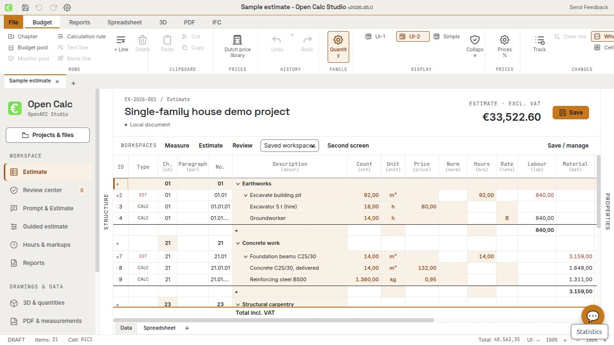
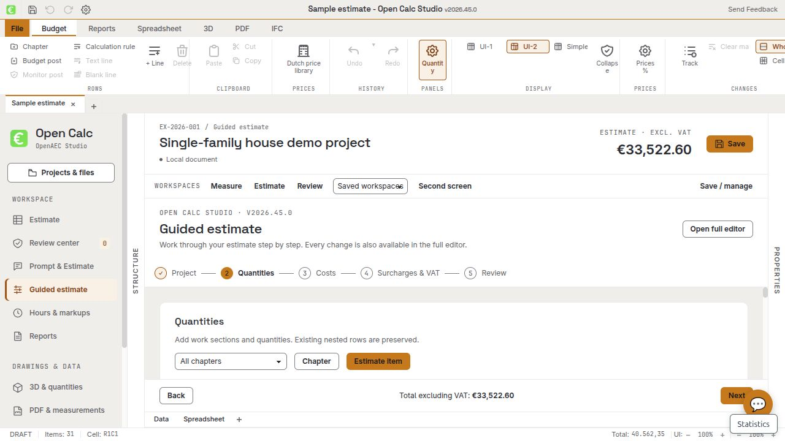
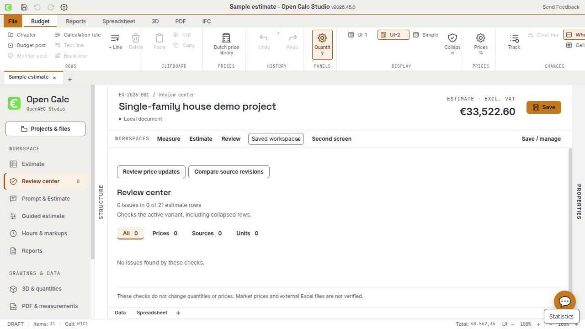
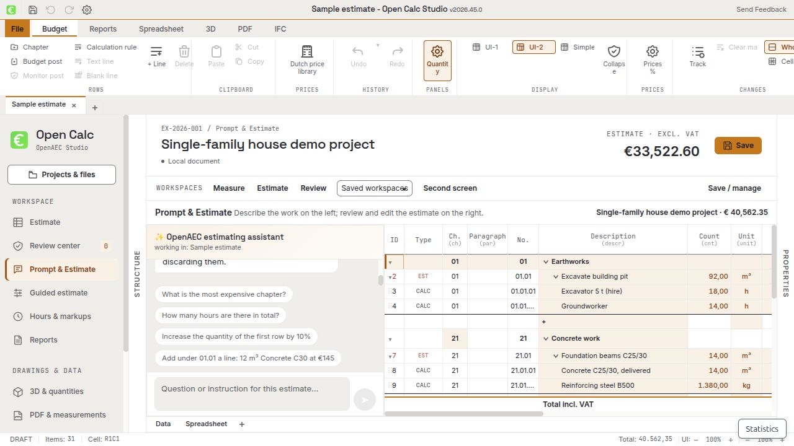

# Open Calc Studio

Open-source construction cost estimating for desktop, browser and embedded applications.

[](LICENSE)
[](https://github.com/OpenAEC-Foundation/open-calc-studio/releases/latest)
[](https://github.com/OpenAEC-Foundation/open-calc-studio/actions/workflows/build.yml)

**[Download 2026.46.0](https://github.com/OpenAEC-Foundation/open-calc-studio/releases/tag/v2026.46.0)** · **[Try the browser app](https://open-calc-studio.open-aec.com/)** · [User guide](docs/user-guide.md) · [Nederlandse handleiding](docs/gebruikershandleiding.md)

Build an estimate, bring in spreadsheet/PDF/IFC quantities, review the sources
and prices, and prepare reports. Use the full editor or follow the guided
workflow; both work on the same project.

## Screenshots

Estimate editor with the public single-family-house example (screenshots from 2026.45.0):

[](docs/screenshots/2026.45.0/estimate.jpg)

<details>
<summary>More screenshots: guided estimate, review center and Prompt &amp; Estimate</summary>

### Guided estimate

Choose **Guided estimate** in the sidebar to work through project details,
quantities, costs, surcharges/VAT and review. Return with **Open full editor**.

[](docs/screenshots/2026.45.0/guided-estimate.jpg)

### Review center

Choose **Review center** to inspect price, quantity-source and unit checks.
The same workspace opens catalogue-price updates and source-revision comparisons.

[](docs/screenshots/2026.45.0/review-center.jpg)

### Prompt & Estimate

Choose **Prompt & Estimate** to keep the estimating assistant beside the grid.
Review a financial proposal before applying it; AI service configuration is required
for assistant requests. The screenshot shows the interface without sending a prompt.

[](docs/screenshots/2026.45.0/prompt-estimate.jpg)

</details>

Captured from the live web app on **5 November 2026**, version **2026.45.0**,
using public sample data. [Screenshot sources](docs/screenshots/2026.45.0/README.md).

## Start with a sample

1. Open the [browser app](https://open-calc-studio.open-aec.com/) or install a desktop package below.
2. Use **Projects & files** to open an estimate or the example project.
3. Edit in **Estimate**, or choose **Guided estimate** for the five-step route.
4. Use **Review center** to inspect sources, units and prices before delivery.
5. Save a native `.ifcCalc` project. In a standalone browser, saving downloads a copy;
   a hosted session saves through its site's storage contract.

## Downloads

**Upgrade note:** production capacity now divides both hours and labour cost on
rate-group lines. Existing estimates with capacity other than 1 may show lower
labour totals. [Calculation changes](docs/release-notes/v2026.46.0.md).

The signed **2026.46.0** release is available for all three desktop platforms:

| Platform | Packages | Verification |
| --- | --- | --- |
| Windows x64 | [EXE](https://github.com/OpenAEC-Foundation/open-calc-studio/releases/download/v2026.46.0/Open.Calc.Studio_2026.46.0_x64-setup.exe), [MSI](https://github.com/OpenAEC-Foundation/open-calc-studio/releases/download/v2026.46.0/Open.Calc.Studio_2026.46.0_x64_en-US.msi) | Authenticode; installed app, uninstaller and native DLL checked in CI |
| macOS Intel + Apple Silicon | [Universal DMG](https://github.com/OpenAEC-Foundation/open-calc-studio/releases/download/v2026.46.0/Open.Calc.Studio_2026.46.0_universal.dmg) | Developer ID, Apple notarization, Gatekeeper and stapled ticket |
| Linux x64 | [AppImage](https://github.com/OpenAEC-Foundation/open-calc-studio/releases/download/v2026.46.0/Open.Calc.Studio_2026.46.0_amd64.AppImage), [DEB](https://github.com/OpenAEC-Foundation/open-calc-studio/releases/download/v2026.46.0/Open.Calc.Studio_2026.46.0_amd64.deb), [RPM](https://github.com/OpenAEC-Foundation/open-calc-studio/releases/download/v2026.46.0/Open.Calc.Studio-2026.46.0-1.x86_64.rpm) | Detached OpenPGP signatures and the public key accompany the packages |

The [release page](https://github.com/OpenAEC-Foundation/open-calc-studio/releases/tag/v2026.46.0)
also includes checksums, updater signatures/manifest, the signed Windows DLL
archive, and SDK, hosted-web and headless-API packages. Snap **2026.46.0** is
on stable as revision **10**, with public product metadata **LGPL-3.0-only**.
The release asset ending in `-store.snap` matches that Store build and has its
own checksum; the earlier Snap archive is retained unchanged.
The project remains in public testing.

[Signature verification](docs/desktop-builds.md) · [macOS startup help](docs/macos-startup.md) · [Release notes](docs/release-notes/v2026.46.0.md)

## Run from source

For a local web application, install Node.js 22.18 or newer and run:

```sh
git clone --recurse-submodules https://github.com/OpenAEC-Foundation/open-calc-studio.git
cd open-calc-studio
npm ci
npm run dev
```

Open [localhost:4200](http://localhost:4200/). To package the desktop application, install Rust and the [Tauri system prerequisites](https://v2.tauri.app/start/prerequisites/), then run:

```sh
npm --prefix mcp-server ci
npm --prefix mcp-server run bundle
npm run tauri -- build
```

For the mobile browser, serve a web build over HTTPS. Android and iPhone use the same project format and calculator. Native-only reporting and IFC/PDF workspaces remain in the desktop interface. [Mobile guide](docs/mobiele-webapp.md).

## Features

- Navigable structure tree with synchronized selection, drag-and-drop, context-menu moves and depth controls.
- Per-estimate currency and explicit number notation; changing currency never converts amounts.
- [Shared OpenAEC IFCX import](docs/ifcx-interoperability.md), retaining model references, source rates and rounded amounts while protecting exchange source files from native overwrite.
- Hierarchical estimates with chapters, cost items, production norms, hourly rates, resource classifications, overhead, profit, mixed VAT and rounding.
- Editable grid, spreadsheets, variants, snapshots, reports, quantities from IFC-Lite and persisted PDF measurements.
- General Excel/CSV column mapping, including Spanish headers, hierarchical chapter codes and labour/material/equipment cost splits.
- Catalogue price provenance, selective price updates and source-revision review with undo; multi-document recovery and native saves with a previous-version backup.
- Optional five-step **calculation wizard** sharing the editor's project and calculator, with a direct return to the full editor.
- **Prompt & Begroot** with financial previews, changed-row details and assumptions; approve or undo a complete proposal as one transaction.
- Save task workspaces for measuring, estimating and review, including panel widths, zoom and columns. Open PDF drawings or quantity origins on a synchronized, read-only second screen.
- Inspect quantity provenance from PDF, IFC or spreadsheet sources, with saved source identity, page/object references, calculation and missing-source/unit warnings.
- **Review center** in the sidebar: live price, source and unit checks for the active variant, with category filters, exact row navigation and a return button. Also available on mobile, through desktop MCP and as the pure SDK function `reviewBudget`.
- Import/export for native `.ifcCalc`, BC3, ÖNORM A 2063, CUF/RSX and IFC; importers for legacy Dutch tools, GAEB, IBIS-TRAD and spreadsheets. See [format support and limitations](docs/wereldwijde-uitwisseling.md).
- A workspace with persistent navigation, a project header and live estimate total, using official [OpenAEC Blueprint](docs/blueprint-alignment.md) typography, local fonts and five themes. Project files open in a drawer; spreadsheet tabs stay beside the estimate.
- Hosted platform build with optional `window.openaecHost` storage, file versions and conflict protection; no own accounts, user extensions or personal AI keys in this build.
- React/JavaScript SDK, isolated iframe embedding, standalone stdio MCP, desktop automation API, and a separate authenticated headless REST/HTTP-MCP calculation service.

[NL gebruikershandleiding](docs/gebruikershandleiding.md) · [English user guide](docs/user-guide.md) · [Wiki sources](wiki/Home.md) · [Wizard](docs/calculation-wizard.md) · [Prompt & Begroot](docs/prompt-begroot.md) · [IFC-Lite](docs/ifc-lite-splitview.md) · [PDF integration](docs/pdf-studio-integration.md).

## Versions and delivery status

The current published release is **[2026.46.0](https://github.com/OpenAEC-Foundation/open-calc-studio/releases/tag/v2026.46.0)**, using `year.ISOweek.patch`. Product packages, Cargo and MCP share this version. MSI uses `26.46.0` to fit the Windows major-version limit. The `.ifcCalc` **file format is 2.4.0**; it has its own compatibility policy and is not a product release number.

The release source passed **1,525 tests** (six skipped), six platform-isolation tests,
and native library/API checks on Windows, macOS and Linux. Signing and updater
verification succeeded in [release CI](https://github.com/OpenAEC-Foundation/open-calc-studio/actions/runs/42962816974).
An SDK archive is available; this does not assert publication to the npm registry.

Real Android/iPhone acceptance, clean-machine installation and AWS deployment
remain open. Standalone production account sign-in requires a registered account
configuration. The DynLex work is a small research prototype, not a rewrite.
[Release notes](docs/release-notes/v2026.46.0.md) · [Issue acceptance matrix](docs/issue-readiness.md).

| Distribution | Interface and boundary | Documentation |
| --- | --- | --- |
| Desktop | Tauri 2; Windows x64, Linux x64, universal macOS installer workflows | [Build/signing](docs/desktop-builds.md) |
| Hosted web/mobile | Static platform build; host-owned storage and authentication | [SuperCloud contract](docs/supercloud.md) |
| React/JS SDK | `@openaec/open-calc-studio`, `/core`, `/isolated`, `/importers`, `/converters` | [Library integration](docs/library-integration.md) |
| Native library | Public ABI 1; Windows DLL, Linux .so, macOS .dylib build matrix; runs the desktop UI | [C/C# examples](packages/native/README.md) |
| Headless service | Two inline calculation tools over REST and HTTP-MCP; no desktop or server file access | [Cloud API / AWS template](docs/cloud-api.md) |
| Standalone MCP | stdio; budget files, converters and an optional desktop bridge | [MCP setup](mcp-server/README.md), [desktop automation](docs/mcp-desktop.md) |

A native UI library is not the headless calculation API. An MCP server is not by itself an interactive Claude connector. See the acceptance matrix for what has actually been verified.

## Recovery, catalogue updates and source revisions

Open the **Review center** to compare catalogue prices or source revisions.
Projects retain the applied price source, date and catalogue version. Price
updates and IFC revision relinks are previewed, explicitly selected and undoable;
manual overrides, incompatible units/currencies and inactive variants are preserved.
PDF measurement exchange verifies `sourceHash`; legacy exports need explicit
approval and remain visibly unverified. IFC comparisons cover identity and named
quantities, not geometry-only changes.

A separate IndexedDB journal retains all open documents and snapshots when work
is modified. Recovery opens new estimates, without overwriting original files.
Native saves keep the previous version as `.bak` and replace the destination
through a temporary file. See the [user guide](docs/user-guide.md) and
[validation and performance evidence](docs/research/project-safeguards-2026-10-30/README.md).


## Account sign-in

Public builds keep standalone OpenAEC sign-in disabled. Hosted sessions use the
site's authentication. An explicitly enabled desktop build requires a registered
OIDC client and `OPENAEC_ACCOUNTS_CONFIG`; it no longer falls back to developer
hosts. See [account configuration and verification](docs/accounts-sign-in.md).

## Developers

```sh
npm run version:check
npm run test:version
npm run check:blueprint
npx tsc --noEmit
npm test -- --maxWorkers=2 --testTimeout=20000
npm run build
npm run build:platform -- --base /assets/open_aec/open-calc-studio/ --outDir dist-platform
npm run build:lib
npm run test:server
```

Use `npm run pack:lib` for the npm archive. Use `npm run build:server` for a standalone Node.js service; it refuses to start without configured key digests. Web, SDK, API and native distributions include notices and build metadata. [Library integration](docs/library-integration.md) explains independent instances and compatibility. [File format](docs/ifccalc-formaat.md) and [model/API reference](docs/API.md) describe the data boundary.

Prepare a calendar version with `node scripts/version.mjs next` or `node scripts/version.mjs set 2026.46.1`. The **Prepare calendar release** GitHub workflow creates a version PR. Release CI checks `v<version>` against all packages, runs mandatory type/tests, builds platform/API/embed artifacts and requires verified desktop signing. It publishes a draft release on successful tagged builds. It does not deploy AWS.

## Docker

The graphical Linux app has a container build alongside the separate headless
API image. The desktop image is prepared from the release's exact `.deb`, tested
before release creation, and configured for publication after a stable release.

**Public access is blocked:** the GHCR package is private and its Public option
is disabled by organization administrators ([#35](https://github.com/OpenAEC-Foundation/open-calc-studio/issues/35)).
An administrator must enable public distribution; CI credentials do not make
an anonymous pull possible. After public access is enabled, run:

```sh
docker run --rm -p 3000:3000 -v /path/to/files:/openaec -v calc-config:/config \
  -e OPENAEC_LANGUAGE=nl -e OPENAEC_THEME=light \
  ghcr.io/openaec-foundation/open-calc-studio:latest
```

Open `http://localhost:3000`. The app runs as UID 1000, without FUSE,
root privileges or a GPU. Mounted folders must be writable by UID 1000.
`/config` persists settings; `/openaec` contains user files. Optional environment
variables: `OPENAEC_START_FILE` (a file under `/openaec`), `OPENAEC_RESOLUTION`
(default `1440x900`), `OPENAEC_LANGUAGE` (interface language code), and
`OPENAEC_THEME` (`light`, `dark`, `blueprint`, `high-contrast-dark`,
`high-contrast-light`, `system`). Existing preferences remain when no override is given.

Health: `GET /gezond`; it fails when the app/display/MCP process is unavailable.
The full MCP server listens at port **9743**, path `/mcp`, for the private container
network. Do not publish that port with `-p`; optionally set `OCS_MCP_TOKEN` for
Bearer authentication. REST/WS remain on container loopback. Optional analytics,
account, feedback and release-fetch services are disabled; no outbound service is
required for normal startup. The stream has no built-in account login: the
SuperCloud reverse proxy supplies authentication and TLS.

Runtime logs, an app screenshot and measured idle memory are uploaded as
`open-calc-studio-desktop-container-evidence`. The release-event workflow verifies
publication, cosign signatures and provenance/SBOM. These checks do not replace
an anonymous-pull check or acceptance in the actual SuperCloud environment.

## Contributing

Please use [Issues](https://github.com/OpenAEC-Foundation/open-calc-studio/issues) for reproducible bugs and proposals, and submit focused pull requests with relevant verification. Preserve calculator totals, native-file compatibility and host isolation. Use the pinned Blueprint assets and `--oa-*` roles; retain upstream license notices. Keep client estimates, credentials and generated build directories out of Git.

## License

Open Calc Studio code: **LGPL-3.0-only**, see [LICENSE](LICENSE) and [COPYING](COPYING). Blueprint CSS: **CC-BY-SA-4.0**; bundled fonts: **OFL-1.1**. Other bundled dependencies retain their respective licenses. [NOTICE.md](NOTICE.md) records attribution and distribution requirements. The Blueprint B2 icons have not been imported pending a clear license.

The embed npm package includes `LICENSE`, `COPYING` and `NOTICE.md` at its root;
web distributions also provide the product, Blueprint and font notices in `licenses/`.
