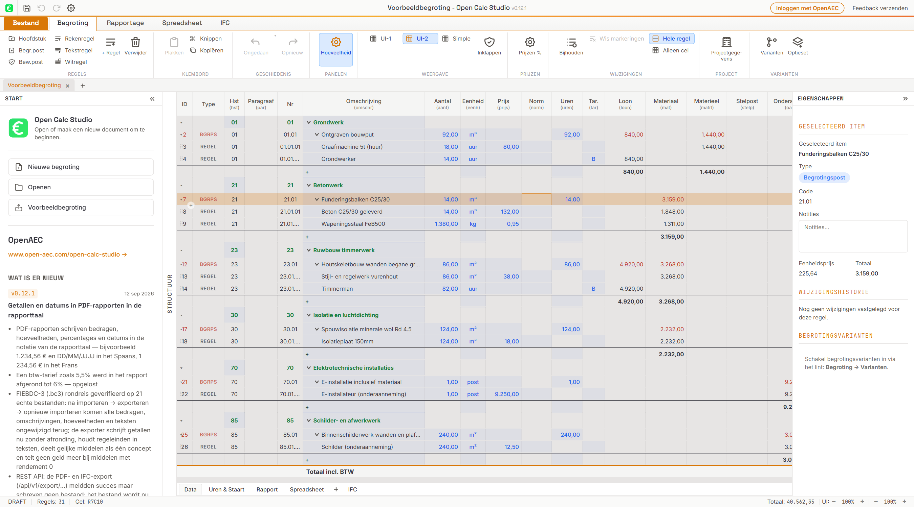

# Open Calc Studio

Open-source construction cost estimating for desktop, browser and embedded applications.

[](LICENSE)
[](https://github.com/OpenAEC-Foundation/open-calc-studio/actions/workflows/build.yml)



## Install

Download available Windows, macOS or Linux packages from [Releases](https://github.com/OpenAEC-Foundation/open-calc-studio/releases). Check the version, architecture, checksums and signing evidence for the artifact you download. The project is in public testing. [Desktop builds and signature verification](docs/desktop-builds.md) · [macOS startup help](docs/macos-startup.md).

For a local web application, install Node.js 22.18 or newer and run:

```sh
npm ci
npm run dev
```

Open [localhost:4200](http://localhost:4200/). To package the desktop application, install Rust and the [Tauri system prerequisites](https://v2.tauri.app/start/prerequisites/), then run:

```sh
npm --prefix mcp-server ci
npm --prefix mcp-server run bundle
npm run tauri -- build
```

For the mobile browser, serve a web build over HTTPS. Android and iPhone use the same project format and calculator. Native-only reporting and IFC/PDF workspaces remain in the desktop interface. [Mobile guide](docs/mobiele-webapp.md).

## Features

- Hierarchical estimates with chapters, cost items, production norms, hourly rates, resource classifications, overhead, profit, mixed VAT and rounding.
- Editable grid, spreadsheets, variants, snapshots, reports, quantities from IFC-Lite and persisted PDF measurements.
- Optional five-step **calculation wizard** sharing the editor's project and calculator, with a direct return to the full editor.
- **Prompt & Begroot** for reviewing proposed estimate changes before applying them.
- Import/export for native `.ifcCalc`, BC3, ÖNORM A 2063, CUF/RSX and IFC; importers for legacy Dutch tools, GAEB, IBIS-TRAD and spreadsheets. See [format support and limitations](docs/wereldwijde-uitwisseling.md).
- A workspace with persistent navigation, a project header and live estimate total, using official [OpenAEC Blueprint](docs/blueprint-alignment.md) typography, local fonts and five themes. Project files open in a drawer; spreadsheet tabs stay beside the estimate.
- Hosted platform build with optional `window.openaecHost` storage, file versions and conflict protection; no own accounts, user extensions or personal AI keys in this build.
- React/JavaScript SDK, isolated iframe embedding, standalone stdio MCP, desktop automation API, and a separate authenticated headless REST/HTTP-MCP calculation service.

[NL gebruikershandleiding](docs/gebruikershandleiding.md) · [English user guide](docs/user-guide.md) · [Wiki sources](wiki/Home.md) · [Wizard](docs/calculation-wizard.md) · [Prompt & Begroot](docs/prompt-begroot.md) · [IFC-Lite](docs/ifc-lite-splitview.md) · [PDF integration](docs/pdf-studio-integration.md).

## Versions and delivery status

The current development version is **2026.44.0**, using `year.ISOweek.patch`. Product packages, Cargo and MCP share this version. MSI uses `26.44.0` to fit the Windows major-version limit. The `.ifcCalc` **file format remains 2.2.0**; it has its own compatibility policy and is not a product release number.

This source version does not imply an installer or npm publication already exists. [Release notes](docs/release-notes/unreleased.md) and the [issue acceptance matrix](docs/issue-readiness.md) record implementation, test evidence and remaining work. Signed releases require working signing credentials and verification of the delivered artifacts. Actual AWS deployment, clean-machine installation, real-phone tests and the DynLex prototype are still pending.

| Distribution | Interface and boundary | Documentation |
| --- | --- | --- |
| Desktop | Tauri 2; Windows x64, Linux x64, universal macOS installer workflows | [Build/signing](docs/desktop-builds.md) |
| Hosted web/mobile | Static platform build; host-owned storage and authentication | [SuperCloud contract](docs/supercloud.md) |
| React/JS SDK | `@openaec/open-calc-studio`, `/core`, `/isolated`, `/importers`, `/converters` | [Library integration](docs/library-integration.md) |
| Native library | Public ABI 1; Windows DLL, Linux .so, macOS .dylib build matrix; runs the desktop UI | [C/C# examples](packages/native/README.md) |
| Headless service | Two inline calculation tools over REST and HTTP-MCP; no desktop or server file access | [Cloud API / AWS template](docs/cloud-api.md) |
| Standalone MCP | stdio; budget files, converters and an optional desktop bridge | [MCP setup](mcp-server/README.md), [desktop automation](docs/mcp-desktop.md) |

A native UI library is not the headless calculation API. An MCP server is not by itself an interactive Claude connector. See the acceptance matrix for what has actually been verified.

## Developers

```sh
npm run version:check
npm run test:version
npm run check:blueprint
npx tsc --noEmit
npm test -- --maxWorkers=2 --testTimeout=20000
npm run build
npm run build:platform -- --base /assets/open_aec/open-calc-studio/ --outDir dist-platform
npm run build:lib
npm run test:server
```

Use `npm run pack:lib` for the npm archive. Use `npm run build:server` for a standalone Node.js service; it refuses to start without configured key digests. Web, SDK, API and native distributions include notices and build metadata. [Library integration](docs/library-integration.md) explains independent instances and compatibility. [File format](docs/ifccalc-formaat.md) and [model/API reference](docs/API.md) describe the data boundary.

Prepare a calendar version with `node scripts/version.mjs next` or `node scripts/version.mjs set 2026.44.1`. The **Prepare calendar release** GitHub workflow creates a version PR. Release CI checks `v<version>` against all packages, runs mandatory type/tests, builds platform/API/embed artifacts and requires verified desktop signing. It publishes a draft release on successful tagged builds. It does not deploy AWS.

## Contributing

Please use [Issues](https://github.com/OpenAEC-Foundation/open-calc-studio/issues) for reproducible bugs and proposals, and submit focused pull requests with relevant verification. Preserve calculator totals, native-file compatibility and host isolation. Use the pinned Blueprint assets and `--oa-*` roles; retain upstream license notices. Keep client estimates, credentials and generated build directories out of Git.

## License

Open Calc Studio code: **LGPL-3.0-only**, see [LICENSE](LICENSE) and [COPYING](COPYING). Blueprint CSS: **CC-BY-SA-4.0**; bundled fonts: **OFL-1.1**. Other bundled dependencies retain their respective licenses. [NOTICE.md](NOTICE.md) records attribution and distribution requirements. The Blueprint B2 icons have not been imported pending a clear license.
