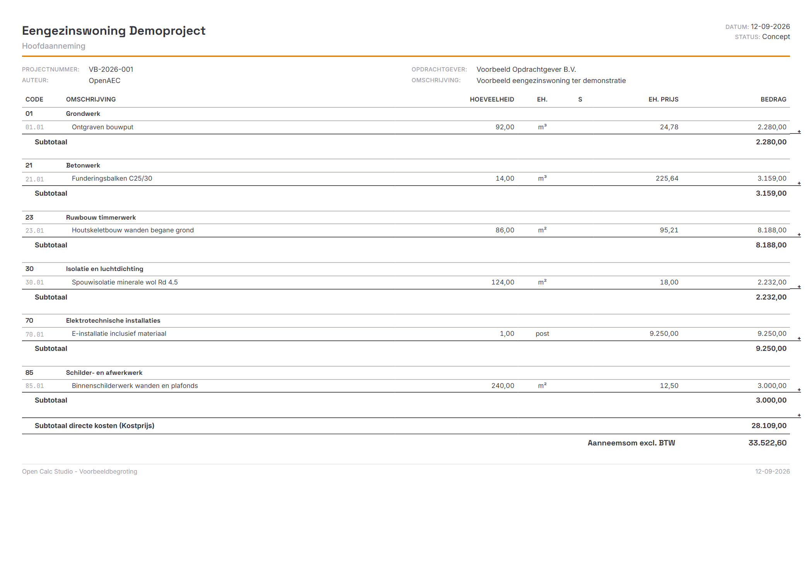

# Gebruikershandleiding Open Calc Studio

Voor de ontwikkelversie 2026.44.4. [English user guide](user-guide.md) · [Projectoverzicht](../README.md)

## Installeren en starten

Download de passende installer voor je besturingssysteem en processor via de [releases](https://github.com/OpenAEC-Foundation/open-calc-studio/releases). Windows gebruikt MSI/EXE, macOS DMG en Linux onder meer DEB/AppImage. Kopieer op macOS de app naar Programma's. Maak een AppImage uitvoerbaar via de bestandseigenschappen. Het aanbod kan per release verschillen.

Blokkeert macOS de app? Volg de [instructies voor macOS](macos-startup.md). Een ontwikkelomgeving of OpenAEC-account is niet nodig voor lokale begrotingen. Cloudopslag en AI via accounttegoed zijn optioneel. Bewaar voor een upgrade een aparte kopie van belangrijke begrotingen; de app is in publieke testfase.

Het lint bovenaan bevat de opdrachten. Bestand opent het bestandsmenu; documenttabbladen wisselen tussen begrotingen. De vaste navigatie links wisselt tussen de werkruimten; onderaan staan de begroting en de rekenbladen van het actieve document. De taal is instelbaar via Bestand → Voorkeuren.

## Wizard en gehoste bestanden

Kies **Calculatiewizard** op het startscherm of in de onderbalk voor vijf stappen: project, hoeveelheden, kosten, toeslagen en controle. De wizard bewerkt dezelfde begroting als Data. **Volledige editor** brengt je terug zonder opnieuw te importeren. Zie de [wizardhandleiding](calculation-wizard.md).

In de gehoste platformbuild regelt de werkplek het openen en opslaan. **Openen** toont bestanden en versies van de host. **Opslaan** controleert de geopende versie; een conflict bewaart je wijzigingen. Gebruik **Opslaan als** voor een bewerkbare kopie van een historische alleen-lezen versie. Zonder host blijf je bestanden lokaal openen en downloaden. Zie het [hostcontract](supercloud.md).

## Je eerste begroting

1. Kies Bestand → Nieuw (Ctrl+N). Laat een eventuele voorbeeldbegroting in een apart tabblad staan ter vergelijking.
2. Vul bij Begroting → Projectgegevens de projectnaam, het nummer en de opdrachtgever in.
3. Voeg via Begroting → Hoofdstuk een hoofdstuk “Schilderwerk” toe.
4. Selecteer het hoofdstuk en voeg een Begrotingspost “Wanden schilderen” toe met aantal `10` en eenheid `m²`.
5. Selecteer de post en voeg een Calculatieregel “Verfmateriaal” toe: aantal `10`, prijs/middel `5`, productienorm en loon leeg. Kies eventueel de middelcategorie materiaal.
6. Controleer het bedrag: deze directe prijsregel levert `10 × 5 = 50` vóór toeslagen. De post en het hoofdstuk moeten eveneens 50 tonen. Het aantal op de post dient hier voor de afgeleide eenheidsprijs; het vermenigvuldigt niet nogmaals het aantal op de onderliggende regel.
7. Sla op met Ctrl+Shift+S, kies een map en behoud de standaardextensie `.ifcCalc`.
8. Open Rapport en controleer omschrijving, hoeveelheid en bedragen.

Dit voorbeeld gebruikt een directe prijs. Bij normregels tellen ook norm, capaciteit en eventueel tariefgroep mee; controleer het resultaat bij een andere rekenwijze.

## Bewerken en indelen

Een hoofdstuk groepeert werk; een begrotingspost beschrijft een post. Onder een begrotingspost kun je een bewakingspost gebruiken. Calculatieregels bevatten de kosten. Tekst- en witregels dienen voor de opmaak.

Selecteer de bedoelde bovenliggende rij voordat je een rij toevoegt. Een bewakingspost vereist een begrotingspost. Met + Regel voeg je een calculatieregel direct onder het geselecteerde item in. Dubbelklik een cel om te bewerken en bevestig met Enter. Selecteer of versleep rijen met de grip links; controleer daarna de structuur.

Het lint biedt Ongedaan maken, Opnieuw, inklappen en procentuele prijsaanpassingen. Maak een kopie vóór brede prijswijzigingen. Varianten en optiesets staan bij Begroting; controleer actieve opties vóór rapportage.

## Uren en staart

Controleer in Uren & Staart de tarieven, uren en toeslagen. Middelcategorieën onderscheiden arbeid, materiaal, materieel, onderaanneming en overig. Bij een arbeidsregel met productienorm en tariefgroep werkt het uurtarief door in de berekening.

De staart berekent ingestelde kostenopslagen, risico, winst, verzekering, btw en afronding achtereenvolgens. Een later percentage kan over een al verhoogd subtotaal gaan. Controleer daarom elke grondslag en tussenuitkomst in plaats van alleen percentages op te tellen. Controleer of de btw-instellingen bij je project passen.

Een aangepast urentotaal schaalt de onderliggende normen naar rato. Bekijk de gewijzigde regels en gebruik Ongedaan maken als dit niet de bedoeling was.

## Opslaan en openen

Bestand → Opslaan bewaart het actieve document; Opslaan als maakt een afzonderlijke kopie. `.ifcCalc` is de standaard voor het eigen formaat; native `.ocs` wordt ook herkend. Bewaar een native hoofdbestand naast exports voor andere programma's.

De desktopapp controleert iedere twee minuten alleen het **actieve** document en slaat het op als het gewijzigd is en al een bestandspad heeft. Nieuwe documenten zonder pad en inactieve tabbladen vallen hier niet onder. Sla nieuwe begrotingen dus eerst zelf op en bewaar andere tabbladen vóór sluiten. In de browser wordt bij opslaan een bestand gedownload; deze desktop-autosave geldt daar niet.

Open een bestand via Bestand → Openen of recente bestanden. Kies bij sluiten bewust tussen Opslaan, Niet opslaan en Annuleren. Bewaar daarnaast een reservekopie.

## Importeren en exporteren

1. Bewaar eerst je huidige werk.
2. Gebruik Bestand → Openen voor ondersteunde begrotingsbestanden, of Bestand → Importeren voor een specifieke importer.
3. Kies het bronbestand. Koppel bij vrije Excel/CSV-import de kolommen aan de gevraagde velden.
4. Lees waarschuwingen en vergelijk structuur, hoeveelheden, eenheden, tarieven, staart en eindbedrag met het bronprogramma.
5. Bewaar het resultaat als nieuw native bestand.

Ondersteunde routes omvatten onder meer WPCalc/BasCalc, IBIS-TRAD, IFC-kostenstructuren, BC3, ÖNORM, CUF/RAW en GAEB DA XML. Controleer Bestand → Extensies als een importer ontbreekt. Een gewoon IFC-model bevat niet noodzakelijk een kostenbegroting. Zie [internationale bestandsuitwisseling](wereldwijde-uitwisseling.md) voor de precieze grenzen; niet elk formaat bewaart alle functies.

Bij GAEB importeer je eerst een `.x83`-bestek. Een `.x84`-aanbieding bevat hoofdzakelijk prijzen en kan pas daarna via **GAEB-aanbieding (.x84)** op dezelfde positienummers worden toegepast. Bewaar het resultaat onder een nieuwe `.ifcCalc`-naam. Controleer de importwaarschuwingen en de totalen: bijlagen, alternatieven en bepaalde tekstvelden komen nog niet volledig mee. GAEB-export is er nog niet.

Gebruik Bestand → Exporteren voor uitwisseling. Controleer de export ook in het ontvangende programma.

## Rapporten en spreadsheets

Open Rapport en kies via Rapportage de gewenste weergave, bijvoorbeeld hoofdaanneming, inschrijfstaat, Bouw 1 of Bouw 2. Stel projectgegevens, logo's, afdrukrichting en rapporteigenschappen in. Controleer paginering, hoeveelheden, subtotalen en btw vóór Printen of PDF-export. Bij afdrukken vanuit de browser is Opslaan als PDF afhankelijk van browser en besturingssysteem.

Maak via Spreadsheet of de + onderaan een deelberekening. Het Spreadsheet-lint verzorgt opmaak; via rechtsklik op een bladtab kun je hernoemen of verwijderen. Sla de begroting op om de bladen te bewaren. Een deelberekening past niet vanzelf een begrotingshoeveelheid aan: controleer een eventuele koppeling en de overgenomen waarde.

## PDF-metingen en Open PDF Studio

Open **PDF & metingen**, voeg een PDF toe, kalibreer een bekende afstand per pagina en meet lengtes of oppervlaktes. Koppel de gemeten hoeveelheid aan een begrotingspost via de hoeveelhedenkiezer, tab PDF. Met Ctrl+S bewaar je de tekening, schaal, meetpunten en koppeling in het native begrotingsbestand. Een PDF mag maximaal 30 MB groot zijn. Controleer gekoppelde hoeveelheden na het verwijderen of vervangen van metingen.

Metingen uit Open PDF Studio kun je via de extensie **Open Calc — metingen** naar JSON exporteren en in dezelfde PDF-bron van Open Calc Studio importeren. Dit is handmatige bestandsuitwisseling; wijzigingen verschijnen pas na een nieuwe export en import. Vergelijk tekening en revisie voordat je hoeveelheden overneemt. De volledige procedure staat in [PDF-metingen en Open PDF Studio](pdf-studio-integration.md).

## Prompt & Begroot en prijsbibliotheek

Open **Prompt & Begroot** om naast de begroting een opdracht te formuleren. Een wijziging verschijnt eerst als voorstel; controleer de regels en kies **Toepassen in begroting**. Je kunt de toepassing in één keer ongedaan maken. Een gerichte opdracht zoals `Voeg onder 21.01 een regel toe: 12,5 m³ Beton C30 à €145,50` kan lokaal werken. Voor vrije vragen en complexere opdrachten is een OpenAEC-aanmelding of ingestelde Anthropic API-sleutel nodig. Het gesprek zelf wordt niet met de begroting opgeslagen. Zie [Prompt & Begroot](prompt-begroot.md).

De Nederlandse prijsbibliotheek bevat startgegevens, geen gegarandeerd actuele marktprijzen. Kies een passende regio, peildatum en bron, controleer eenheid en inhoud van de post en leg je eigen leveranciersprijzen vast voordat je een aanbieding verstuurt. Zie [Nederlandse prijsbibliotheek](nederlandse-prijsbibliotheek.md).

## MCP-server

De meegeleverde MCP-server laat een MCP-client begrotingen openen, bewerken, berekenen en een aantal formaten importeren of exporteren. De desktopapp schrijft bij de start een configuratiebestand naar `~/.claude/open-calc-studio-mcp.json`; daarvoor moet Node.js beschikbaar zijn. De `app_*`-tools bedienen de draaiende app, inclusief PDF-metingen en IFC-Lite-selectie en hoeveelhedenovername; `app_list_actions` beschrijft de functies en parameters. GAEB-export is nog niet geïmplementeerd. Vraag in de MCP-client `get_capabilities` op voor de actuele lijst. Zie [MCP-server](../mcp-server/README.md).

## Sneltoetsen en hulp

Gebruik op macOS Command in plaats van Ctrl. Browser of besturingssysteem kan een sneltoets onderscheppen.

| Actie | Toetsen |
| --- | --- |
| Nieuw / Openen | Ctrl+N / Ctrl+O |
| Opslaan / Opslaan als | Ctrl+S / Ctrl+Shift+S |
| Ongedaan / Opnieuw | Ctrl+Z / Ctrl+Y |
| Kopiëren / Knippen / Plakken | Ctrl+C / Ctrl+X / Ctrl+V |
| Calculatieregel toevoegen | Ctrl+Enter |
| Geselecteerde rijen verwijderen | Delete, buiten celbewerking |
| Afdrukken | Ctrl+P |
| Inzoomen / Uitzoomen / Herstellen | Ctrl+Plus / Ctrl+Minus / Ctrl+0 |

Klopt een totaal niet, controleer dan rijtype, structuur, aantal, norm, prijs, loon, tariefgroep en staart. Ontbreekt een importer, controleer extensies en het werkelijke bronformaat. Ontbreekt een opgeslagen bestand, controleer het actieve tabblad en de bestemming.

Meld een probleem via de [issues](https://github.com/OpenAEC-Foundation/open-calc-studio/issues) met versie, besturingssysteem, stappen, verwacht en werkelijk resultaat. Gebruik een klein geanonimiseerd voorbeeld. Technische documentatie: [API](API.md) en [bestandsformaat](ifccalc-formaat.md).

## Werkplekken en een tweede scherm

Kies onder de projectkop **Meten**, **Begroten** of **Controleren**.
Met **Opslaan / beheren** bewaar je de huidige weergave, paneelbreedten,
raster- en PDF-zoom en zichtbare kolommen als eigen werkplek. Kies deze later
uit de lijst, werk haar bij of verwijder haar. De laatst gekozen werkplek
wordt bij het volgende starten hersteld. De begrotingsinhoud verandert niet.

**Tweede scherm** opent een alleen-lezen venster dat de actieve begroting
volgt. Zet het op een andere monitor en kies **PDF-tekening** of
**Herkomst hoeveelheid**. Een geselecteerde PDF-koppeling in het hoofdvenster
opent de juiste tekening/pagina. Bewerken doe je in het hoofdvenster.
Bij een verbroken verbinding staat erbij dat de laatst ontvangen gegevens
worden getoond. Sta zo nodig het extra venster toe in de browser; de functie
werkt in de zelfstandige desktop- en webapp, niet in ingebouwde frames.

## Controlecentrum

Klik links op **Controlecentrum**; de teller toont het aantal actuele
meldingen. Op een telefoon kies je **Controle** in de onderste navigatie.
Filter op **Prijzen**, **Bronnen** of **Eenheden**, selecteer een melding en
kies **Toon regel**. De juiste regel wordt geselecteerd en bovenliggende
regels worden zo nodig uitgeklapt. Op mobiel opent het regelvenster.
**Terug naar controlecentrum** bewaart je categorie en melding. Wisselen
van document wist deze navigatiecontext.

De controles omvatten de actieve variant, inclusief ingeklapte regels.
Ontbrekende prijsinvoer wordt gemeld bij kostenregels met een hoeveelheid
ongelijk aan nul. Opgetelde bovenliggende regels, tekst, pro-memoria en
nulhoeveelheden krijgen hiervoor geen melding. Een expliciete nulprijs
geldt als ingevuld. Broncontroles melden ontbrekende/niet-numerieke
verwijzingen, afwijkende bronwaarden en verschillende eenheden. Bewaarde
IFC-hoeveelheden blijven bruikbaar zonder geladen geometrie. Externe
Excel-verwijzingen staan als niet-gecontroleerde informatie vermeld.

Deze controles bewijzen geen marktconforme prijzen of volledige begroting.
Bekijken wijzigt geen waarden, wijzigingsstatus of undo-geschiedenis.
Opgeloste meldingen verdwijnen automatisch.

## De herkomst van een hoeveelheid bekijken

Klik op het koppelingsicoon bij een hoeveelheid of bekijk de kaart
**Herkomst hoeveelheid** in Eigenschappen. Je ziet de PDF en pagina,
het IFC-model met objectselectie en benoemde hoeveelheid, of de rekenbladcel
met formule. **Bron openen** navigeert naar de bron. Voor markering van
IFC-geometrie kan het nodig zijn het oorspronkelijke model opnieuw te openen.
Externe Excel-bestanden staan als niet-gecontroleerde verwijzing vermeld.

De bronidentiteit en de koppelwaarde worden met het project opgeslagen.
Verdwijnt een bron, dan blijven die gegevens en de laatst bekende hoeveelheid
bewaard. Een afwijkende eenheid levert een waarschuwing op, geen stille conversie.

## Een assistentvoorstel beoordelen

Een voorstel in **Prompt & Begroot** toont directe kosten, totaal exclusief
btw, btw en totaal inclusief btw vóór en na de wijziging, plus gewijzigde
regels en aannames. Ook bovenliggende totalen staan in de regellijst; tel
hun verschillen niet bij de verschillen van onderliggende regels op.

**Toepassen op begroting** verwerkt het volledige voorstel met één undo-stap.
**Verwerpen** verandert niets. **Gehele voorstel ongedaan maken** draait de
hele wijziging terug. Maak latere bewerkingen eerst ongedaan als die knop
niet beschikbaar is. Bij gewijzigde invoer of een andere actieve begroting
moet je het voorstel opnieuw voorbereiden. Voorstellen blijven alleen deze
sessie beschikbaar. Wijzig gekoppelde hoeveelheden bij de bron of ontkoppel
ze voordat je ze overschrijft.

## Invoer, herstel en IFC-selectie (2026.44.4)

Op mobiel volgt de getalinvoer je interfacetaal: Engels `1.234` betekent
1,234 eenheden; Nederlands `1.234` betekent 1234 eenheden. Voor een
Nederlandse decimaal gebruik je `1,234`. Nul is een ingevulde prijs;
een leeg veld betekent dat de prijs ontbreekt. Bedragen volgen de projectvaluta.
Met **Ongedaan maken** en **Opnieuw uitvoeren** bovenin herstel je mobiele
regelwijzigingen. Gekoppelde hoeveelheden kun je pas aanpassen na
**Hoeveelheid ontkoppelen**; **Gereed** bevestigt dit, sluiten annuleert het.

De wizard houdt ongeldige conceptinvoer apart van de begrotingswaarden.
**Ga naar ongeldig veld** heropent ook een veld dat door een hoofdstukfilter
verborgen is. **Ongeldige invoer verwijderen** herstelt de laatst geldige
waarden. Je kunt altijd naar de volledige editor terug.

In **3D & hoeveelheden** kun je alle IFC-elementen via pagina's van 100
bereiken. De teller toont zoekresultaten en het modeltotaal. **Alle resultaten
selecteren** omvat ook de andere pagina's; controleer de selectieteller vóór
het overnemen van een hoeveelheid. **Selectie wissen** maakt de selectie leeg.
