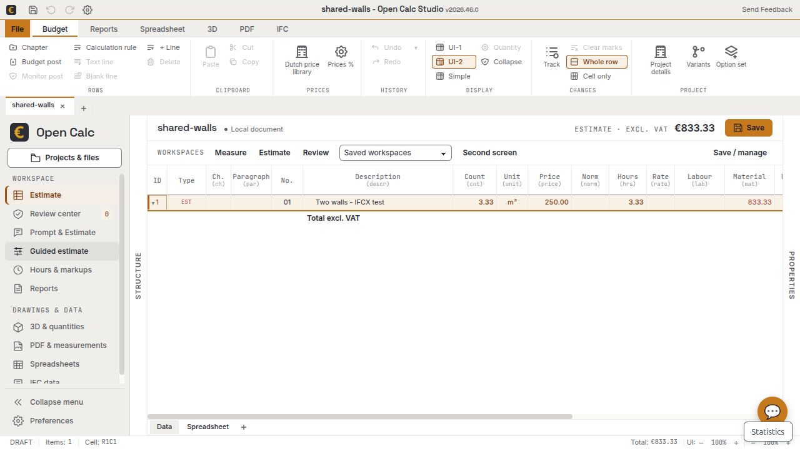

# Shared OpenAEC IFCX import

Version 2026.46.0 adds the first import profile for issue #69. Existing
`ifcx::cost::…` / `ifcx::ocs::…` imports and Calc exports keep their existing format.
This is an interoperability experiment, not a final shared schema decision.

| Explorer field | Calc value |
| --- | --- |
| Node `path` | Stable item `id`; original path also retained in notes |
| `openaec::cost::estimateItem.quantity` | Reference to a node with `openaec::quantity` |
| Quantity `value`, `unit` | Item quantity and normalized quantity unit |
| Estimate `rate`, `currency`, `unit` | Original rate and tariff unit retained in notes; schedule currency |
| Estimate `total` | Rounded line amount; editable native rate = total / quantity |
| `openaec::links[].target` | All model paths retained as source references and in notes |
| `openaec::label`, quantity `formula` | Description and captured quantity origin |
| `status`, `assumption` | Retained in notes; no assumption is treated as verified |

The tariff unit (`EUR/m³`) differs from the quantity unit (`m³`). The amount must
equal quantity × source rate rounded to cents. Calc's effective native rate may
therefore differ slightly from the source rate, preserving the rounded line
amount on recalculation, as Explorer's Calc adapter does. No VAT or overhead is
invented; the imported schedule is explicitly direct-costs-only.

Import a **composed JSON document** containing the estimate and its referenced
quantity nodes in `data`. Calc does not download external `imports`, access a
model service, infer a missing quantity or update quantities live. Unresolved
references, duplicate paths, mixed cost profiles, mixed currencies, unknown
quantity units and inconsistent amounts fail before a budget is installed.
Free items carry their quantity inline (see below). Multiple model references
are preserved; geometry selection is not claimed.

## Proposed shared contract (Calc side)

Open Calc Studio's proposal for the open points in issue #69. It changes nothing
in the existing Explorer files: every document the Explorer writes today stays
valid.

1. **Key name.** `openaec::cost::estimateItem` stays the exchange name
   (`costItem` is already taken by the Explorer's kilogram items).
2. **Units.** `unit` on the estimate is the **rate** unit (`EUR/m³`); the
   **quantity** unit sits with the quantity. Calc's own `unit` maps to the
   quantity unit. A rate unit must equal `<currency>/<quantity unit>`.
3. **Free items.** `quantity` is either a path to an `openaec::quantity` node
   or an inline object `{ "value": 1, "unit": "post", "formula"?: "…" }` for an
   item without a model quantity (a typed quantity). Inline quantities follow
   the same unit and amount checks.
4. **Several model links.** `openaec::links` may hold any number of targets
   (one item for five window frames); all are kept as source references.
5. **Amount.** `total` = quantity × `rate`, rounded to cents. A lump sum
   without a quantity is written as `{ "value": 1, "unit": "post" }`.
6. **Scope.** The shared profile exchanges priced line items, direct costs
   only: no chapter structure, no underlying calculation rules, no overheads
   or VAT. The full budget keeps travelling as Calc's own IFCX
   (`ifcx::cost::…` / `ifcx::ocs::…`), which stays readable and unchanged.
   New Calc-specific settings, if ever needed in IFCX, go under
   `openaec::calc::…`.

### Writing the shared profile

Calc writes the shared profile next to its full IFCX export: **IFC → Download
(OpenAEC IFCX)** in the app, or `export_ifcx` with `profile: "openaec"` over MCP.
One `estimateItem` per top-level post (the first cost row under the chapters),
with the post's rolled-up amount and only the active variant. Items that came
from the Explorer keep their path, quantity reference, links, source rate and
status; other items get `/estimates/<id>` and an inline quantity. Calc reads
its own shared export back to the same direct costs (`src/test/openaecIfcxExport.test.ts`).

## Reproduce the reference probe

The integration was checked against Explorer commit
`10917460b67133891870d354b75221d714d63022`, using
`examples/reference-school/cost/estimates.ifcx` and
`examples/reference-school/quantities/elements.ifcx`. Keep these input files
outside this repository; the unit fixture is independently authored.

```sh
npx esbuild verification/ifcx-import-probe.ts --bundle --platform=node --format=esm --outfile=/tmp/ocs-ifcx-probe.mjs
node /tmp/ocs-ifcx-probe.mjs /path/to/estimates.ifcx /path/to/elements.ifcx
```

The probe checks the production importer, recalculation, native serialization,
reopening and retention of quantity provenance. This does not verify the
geometry, validate the model's measurements or certify its illustrative rates.

Observed on 11 November 2026: **2,703 items**, **EUR 397,443.12** direct costs;
maximum per-line difference after save/reopen: **2.2737367544323206e-13 EUR**.

Sources: [proposal and maintainer discussion](https://github.com/OpenAEC-Foundation/open-calc-studio/issues/69),
[Explorer adapter](https://github.com/OpenAEC-Foundation/ifcx-explorer/blob/10917460b67133891870d354b75221d714d63022/viewer/src/studios/adapters.ts).

## Browser verification

The independently authored two-wall fixture was opened through the normal web
file picker on 11 November and saved as `.ifcCalc`. The saved file retained
`/estimates/walls`, 3.333333 m³, all three source references, source rate 250 and
amount 833.33. No model geometry was loaded or certified.


