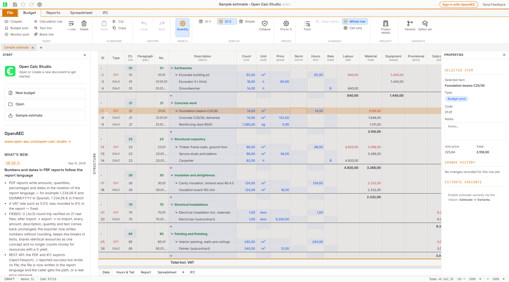
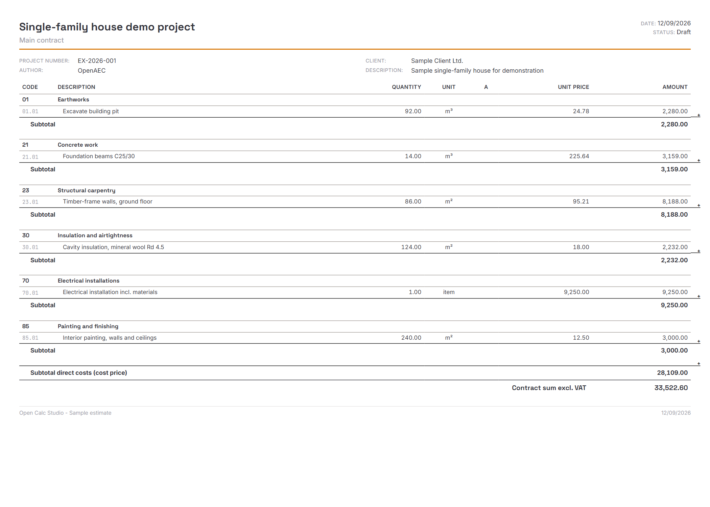

# Open Calc Studio user guide

For Open Calc Studio development version 2026.44.6. [Nederlandse handleiding](gebruikershandleiding.md) · [Project overview](../README.md)

## Contents

- [Install and start](#install-and-start)
- [Your first estimate](#your-first-estimate)
- [Edit and organise](#edit-and-organise)
- [Hours and markups](#hours-and-markups)
- [Save and reopen](#save-and-reopen)
- [Import and export](#import-and-export)
- [Reports and spreadsheets](#reports-and-spreadsheets)
- [Keyboard shortcuts](#keyboard-shortcuts)
- [Review center](#review-center)
- [Troubleshooting](#troubleshooting)

## Install and start

Download an installer for your operating system and processor from the [project releases](https://github.com/OpenAEC-Foundation/open-calc-studio/releases). Windows uses an MSI or EXE installer, macOS a DMG, and Linux offers packages such as DEB and AppImage. Open the installer; on macOS copy the application to Applications before launching it. For an AppImage, enable execution in the file's permissions and run it. Availability varies by release.

If macOS blocks startup, follow the [macOS startup instructions](macos-startup.md).

You do not need a development environment or an OpenAEC account for local estimates. The cloud and account-funded AI features are optional. This project is in public testing; keep a separate copy of important estimates before upgrading.

The ribbon across the top contains commands. File opens the file menu. Document tabs switch between estimates. The bottom tabs switch between Data, Hours & Markups, Report, spreadsheets and IFC for the active document. Labels follow the selected interface language; change it through File → Preferences.



## Your first estimate

1. Choose File → New (Ctrl+N). If an example estimate is open, keep it in its own tab for reference.
2. In Budget → Project details, enter the project name, number and client.
3. Choose Budget → Chapter and enter a description, for example “Painting”.
4. Select that chapter and choose Budget → Budget post. Enter “Paint walls”, quantity `10` and unit `m²`.
5. With the post selected, choose Budget → Calculation rule. Enter “Paint materials”, quantity `10`, resource price `5`, and leave the production norm and labour price empty. Classify it as material if you want a material breakdown.
6. Check the result: this direct-price calculation line contributes `10 × 5 = 50` before markups. The containing post and chapter should show 50. The post's quantity is used to show the derived unit price; do not assume it multiplies the child line quantity again.
7. Save with Ctrl+Shift+S, select a folder and retain the native `.ifcCalc` extension.
8. Open the Report tab and check the description, quantity and totals before printing.

This example deliberately uses a direct price. Norm-based labour and resource lines have additional inputs; check the calculated amounts when switching models or importing them.

## Edit and organise

A chapter groups work. A budget post describes a priced item. A monitor post provides an extra level beneath a budget post. Calculation rules contain the underlying costs. Text and blank lines organise the presentation without adding costs.

Select the intended parent before adding a row from Budget. A monitor post requires an existing budget post. The + Line command adds a calculation rule below the selected item. Edit a cell by double-clicking it, and confirm with Enter. Use the row grip at the left to select or drag rows, including into another chapter. Check the resulting hierarchy after moving rows.

Budget provides Undo, Redo, collapse controls and price adjustment by percentage. Save a copy before applying broad price changes. Variants and option sets are available from Budget; review which options are active before issuing a report.

## Hours and markups

Open Hours & Markups to review labour rates, hours and the estimate's closing calculations. Resource categories distinguish labour, material, equipment, subcontracting and other costs. For labour with a production norm and rate group, the selected hourly rate participates in the calculation.

The closing calculation (Dutch: *staart*) applies configured overheads, risk, profit, insurance, VAT and rounding in sequence. Later percentages can apply to a subtotal that already includes earlier additions, so adding the percentages together will not reproduce the final amount. Review each displayed basis and subtotal.

Editing an hours total proportionally adjusts the underlying norms. Review the affected lines and use Undo if the adjustment was unintended. Check tax settings against the requirements of your project; example values are not a project-specific recommendation.

## Save and reopen

Use File → Save for the active document and Save As for a separate copy. The default native extension is `.ifcCalc`; the app also recognises native `.ocs` files. Native files retain editable project data; exchange exports may contain less information.

The desktop app checks the **active** document every two minutes and saves it if modified and already associated with a file path. New documents without a path and inactive tabs are not covered by this timer. Save every new estimate explicitly and save other tabs before closing. In the browser, saving downloads a file; desktop autosave does not apply.

Use File → Open or Recent Files to reopen a saved estimate. On closing a modified document, choose Save, Discard or Cancel deliberately. Keep backups outside the working file.

## Import and export

1. Save your current work.
2. Use File → Open for supported estimate files, or File → Import to choose a specific importer.
3. Select the source file. For a generic Excel/CSV import, map the source columns to the requested fields.
4. Read any import warnings. Compare the hierarchy, quantities, units, labour rates, markups and final amount with the source application.
5. Save the imported estimate as a new native file before editing further.

Available formats include WPCalc/BasCalc, IBIS-TRAD, IFC cost schedules, BC3 and ÖNORM. Import commands depend on enabled extensions; check File → Extensions if one is missing. Not every format supports every feature. An ordinary 3D IFC model does not necessarily contain an IFC cost schedule.

Use File → Export for exchange formats. Keep a native master copy and check the exported result in the receiving application. See the [project feature list](../README.md#import--export) for format coverage.

## Reports and spreadsheets

Open Report and choose a report layout from Reports, such as main contract, tender schedule, Bouw 1 or Bouw 2. Configure project details, logos, orientation and report properties as needed. Check the preview for page breaks, visible quantities, subtotals and VAT before using Print or PDF Export. Browser printing can also provide a Save as PDF destination, depending on the browser and operating system.



Use the bottom Spreadsheet tab or + button to create a supporting sheet. The Spreadsheet ribbon provides formatting. Right-click a sheet tab to rename or delete it. Save the estimate to preserve its sheets. A supporting calculation does not change an estimate quantity merely because it exists: check any quantity link and its resulting value.

## Keyboard shortcuts

Use Command instead of Ctrl on macOS. Browser or operating-system shortcuts may take precedence.

| Action | Shortcut |
| --- | --- |
| New / Open | Ctrl+N / Ctrl+O |
| Save / Save As | Ctrl+S / Ctrl+Shift+S |
| Undo / Redo | Ctrl+Z / Ctrl+Y |
| Copy / Cut / Paste selected rows | Ctrl+C / Ctrl+X / Ctrl+V |
| Add calculation line | Ctrl+Enter |
| Delete selected rows | Delete, outside cell editing |
| Print | Ctrl+P |
| Zoom in / out / reset | Ctrl+Plus / Ctrl+Minus / Ctrl+0 |

## Troubleshooting

- **Unexpected total:** check row type, hierarchy, line quantity, production norm, resource price, labour price, rate group and markups. Undo the last change to compare.
- **Missing importer:** check enabled extensions and the actual file format, not just its extension.
- **File not saved:** confirm the active tab and destination. Save a new document once before relying on desktop autosave.
- **macOS will not launch:** see [macOS startup](macos-startup.md).
- **Still stuck:** [open an issue](https://github.com/OpenAEC-Foundation/open-calc-studio/issues) with the app version, operating system, reproduction steps and expected/actual result. Use a small anonymised sample instead of confidential project data.

Developers can use the [API documentation](API.md), [native file format](ifccalc-formaat.md) and [build instructions](../README.md#build-from-source).

## Guided and hosted use

Choose Calculation wizard from the start page or bottom navigation. Its five steps share the editor project and calculation engine; Full editor returns to the grid. In a hosted workspace, Open shows host files and versions; Save passes the expected version and retains edits on conflicts. A read-only version can be saved as a new copy. See [wizard](calculation-wizard.md) and [host contract](supercloud.md).

## Task workspaces and a second screen

Under the project header, choose **Measure**, **Estimate** or **Review**.
Use **Save / manage** to save the current view, panel widths, grid/PDF zoom
and visible columns as your own workspace. Choose a saved workspace to restore
it, update it after rearranging, or delete it. Your last selected workspace
is restored at the next startup. These preferences do not modify your estimate.

**Second screen** opens a separate read-only window following the main
window's active estimate. Move it to another monitor and choose **PDF drawing**
or **Quantity origin**. Selecting a linked PDF quantity in the main window
focuses its drawing/page in the second window. Edit quantities and measurements
in the main window. If the main window disconnects, the second window labels
its data as the last received copy. A browser may require allowing the popup;
this feature is available in standalone web and desktop, not embedded frames.

## Review center

Open **Review center** in the left sidebar; its badge counts current issues.
On a phone, choose **Review** in the bottom navigation. Filter by **Prices**,
**Sources** or **Units**, select an issue and choose **Show row**. The editor
reveals the exact row, including collapsed parents; on mobile its editor opens.
**Back to review center** retains the category and selected issue. Switching
documents resets this navigation context.

Checks cover the active estimate variant, including collapsed rows. Missing
price inputs are checked on cost leaves with a nonzero quantity. Parent
rollups, text, pro-memoria and zero-quantity rows are excluded; an explicit
zero price counts as entered. Source checks report missing/non-numeric
references, different linked values and unit mismatches. Saved IFC quantities
remain valid without loaded geometry. External Excel references are labelled
unchecked information, not broken links. These checks verify neither market
prices nor estimate completeness. Values, dirty state and undo history are
unchanged by inspecting an issue; fixed issues disappear automatically.

## Inspect a quantity's origin

Click the link icon next to a quantity, or use **Quantity origin** in the
Properties panel. PDF sources show the drawing identity, page and measurement;
IFC sources show model identity, element IDs and the named quantity;
spreadsheet links show the sheet, cell and formula. **Open source** returns
to that page/cell or selects the IFC objects when the geometry is loaded.
Saved IFC quantities retain their metadata; reopening the original model may
be necessary to highlight geometry. External Excel references are shown
without claiming that their files have been checked.

Source metadata is saved with the estimate. If a source disappears, the card
keeps the captured identity and the estimate keeps its last known quantity.
A unit mismatch is a warning, not an implicit conversion.

## Review an assistant proposal

In **Prompt & Estimate**, send a request or try the example chip. The proposal
shows before/after direct costs, totals excluding VAT, VAT and totals including
VAT, together with changed rows and assumptions. Parent totals also appear in
the row list; their differences must not be added to their children's differences.

**Apply to estimate** approves the complete proposal with one undo entry.
**Discard** leaves the estimate unchanged. **Undo entire proposal** restores
all of its rows together; undo subsequent edits first if the button is disabled.
Changed input data or a different active document invalidate the proposal.
Proposals are session-local and must be prepared again after restarting.
Linked quantities must be changed at their source or unlinked before overriding.

## Input, recovery and IFC selection (2026.44.5)

Mobile numbers follow the interface language: English `1.234` is a fraction;
Dutch `1.234` is 1234, while `1,234` is a fraction. Zero is an explicit price;
a blank field means no price. Amounts use the project currency. Use **Undo**
and **Redo** in the mobile header to recover row edits. Linked quantities are
read-only until **Unlink quantity**; **Done** commits the change, closing
cancels it. Undo restores the original value and link together.

Wizard errors retain the last valid estimate values. **Go to invalid field**
reveals a field hidden by the chapter filter; **Discard invalid drafts**
restores valid input. The full editor remains reachable.

**3D & quantities** displays IFC elements in pages of 100 with result and
model counts. **Select all results** includes every matching element across
all pages. Check the selection count before applying quantities. **Clear
selection** resets it. The MCP equivalent is `ifc.selectFiltered {search}`.

## Recovery and safe saving since 2026.44.6

When an estimate has unsaved changes, a separate IndexedDB journal retains all
open documents, sheets, source data and snapshots. **Recovery saved** means the
transaction completed. Storage failures appear at the top: save a project file
in that case. Abrupt process loss may still lose edits made after the last
checkpoint. Recovery is additional protection, not a replacement for backups.

At the next start choose **Restore as new estimates**. Original files are not
overwritten; use **Save as** afterwards. **Discard recovery** deletes the selected
journal. Embedded PDF bytes, calibration and measurements are preserved. Saved
IFC quantities remain available; reload the correct original IFC file for the
3D geometry. Clearing browser data also removes recovery journals.

Native saving keeps the previous version as `filename.ifcCalc.bak`. Copy it to a
new `.ifcCalc` name to open it if needed. A temporary file is written before the
destination is replaced. Autosave to an existing file follows settings; a new
estimate without a path still needs an explicit save. Closing handles every
modified document. Edits made during a pending save remain marked as modified.

## Price sources and catalogue updates

Applied catalogue prices retain their source, price date, catalogue version and
currency on the estimate row. Inspect these in the properties panel. Manual
price edits protect the row from catalogue refreshes.

Open **Review center → Review price updates** (on a phone, open **Review** first).
The resource picker also links to price updates. Import a newer JSON catalogue
or choose **Compare loaded catalogue**. Keep catalogue and article IDs stable
between versions; row order is not identity. Example:

```json
{
  "id": "my-prices", "version": "2026-11", "currency": "EUR",
  "resources": [{
    "id": "brick-01", "code": "M.01", "description": "Brick",
    "unit": "st", "resourceType": "materiaal", "category": "Masonry",
    "source": "Own supplier quotation", "priceDate": "2026-10-30",
    "defaultUnitPrice": 1.25
  }]
}
```

The preview shows old/new prices and the chapter/total impact of all compatible
changes, including VAT in the estimate total. Check individual rows, then choose
**Apply selected prices**. Only checked rows change; **Undo** reverses the action.
Project overrides, tariff groups, inactive variants and incompatible or missing
units/currencies are protected. Legacy rows without price provenance are excluded from
automatic refresh. Changing the estimate invalidates a prepared preview.

## Compare source revisions

Add both source files in **PDF & measurements** or **3D & quantities**. Open
**Review center → Compare source revisions**, choose PDF or IFC and select both
revisions. The short hash distinguishes files sharing the same name.

IFC comparisons use unique GlobalIds and the exact named quantity key. A new
Express ID alone does not establish a new object. Review linked estimate rows,
check compatible updates and choose **Apply selected quantity links**. Missing
or duplicate objects, unit mismatches, manual quantities and inactive variants
remain for review. Undo restores previous quantities and links. Geometry-only
changes require inspection in the 3D viewer.

PDF comparisons show imported measurement values. Review page identity, scale,
rotation and geometry in the drawing; coordinates are not automatically moved
to another revision. An Open PDF Studio export carrying `sourceHash` must match
the selected PDF. Mismatched hashes are rejected. Legacy exports without a hash
require explicit confirmation and remain visibly unverified in the measurements
and Review center.

## Large spreadsheet imports

Workbook imports are limited to 64 MiB input, 256 MiB declared expanded ZIP data,
100,000 rows, 1,024 columns and a combined budget of two million cells/range
positions. The UI runs imports in a worker with a 30-second deadline. Rejected
imports do not replace the estimate with partial data. Synchronous library
functions enforce the workbook bounds; the UI worker deadline is not a deadline
for every external caller. Use native `.ifcCalc` for complete projects with source
attachments and metadata.
